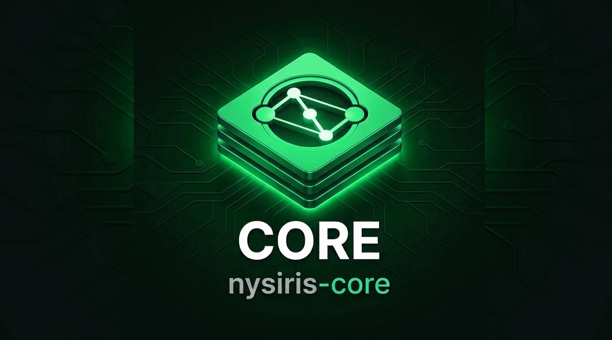

# Nysiris-Core



[](https://github.com/TribeWarez/nysiris-core/actions/workflows/ci.yml)
[](LICENSE)
[](#requirements)
[](https://github.com/sponsors/TribeWarez)

Shared Rust crates for Nysiris-native clients and services: chat identities, a
signed DM envelope, encrypted local history, a transport-agnostic chat engine,
and a real [Nym](https://nymtech.net) transport adapter.

**Project docs:** [Contributing](CONTRIBUTING.md) ·
[Security policy](SECURITY.md) · [Changelog](CHANGELOG.md) ·
[Funding](https://github.com/sponsors/TribeWarez) · [Agent rules](AGENTS.md)

Nysiris-Core is the middle of the dependency graph. It must not depend on
Nysiris or NCC — both consume it:

```text
Nysiris PWA ──wire──► Nysiris services ──► Nysiris-Core
                                              ▲
NCC (PySide6 + ncc-daemon) ───────────────────┘
```

Nysiris services consume the service/social crates; NCC consumes the
chat/transport/history crates. There is no chat service, no server-side message
store, and no SQLite anywhere in this repository.

## Crates

| Crate | Responsibility |
|---|---|
| [`nysiris-core`](crates/nysiris-core) | Identity, DM framing and crypto, contacts, messages, transport trait, sealed files |
| [`nysiris-chat-core`](crates/nysiris-chat-core) | 1:1 chat engine and capability-key rooms over the transport trait |
| [`nysiris-chat-history`](crates/nysiris-chat-history) | Encrypted append-only flat-file history. No SQLite |
| [`nysiris-transport-nym`](crates/nysiris-transport-nym) | Real `nym-sdk` adapter behind the `nym` feature; default builds use an explicit unavailable stub |
| [`nysiris-testkit`](crates/nysiris-testkit) | In-memory transport and test fixtures |

Rooms are capability-key groups: a random room key is shared in a signed
invite, the sender seals one message and fans it out to every member, and there
is no relay or server roster. Rooms are capped at 16 members; removing a member
requires a new room key.

## Quick start

The crates are published on crates.io. Take a caret requirement and let
`Cargo.lock` pin the exact version:

```toml
[dependencies]
nysiris-core = "0.1"
nysiris-chat-core = "0.1"
nysiris-chat-history = "0.1"
```

The real Nym adapter is opt-in and compiles the full `nym-sdk` stack:

```toml
nysiris-transport-nym = { version = "0.1", features = ["nym"] }
```

Without the feature, `NymTransport::connect` fails explicitly instead of
pretending to deliver messages, so the default build stays light and offline.

To track a specific source revision instead, use a git tag:

```toml
nysiris-core = { git = "https://github.com/TribeWarez/nysiris-core", tag = "v0.1.4" }
```

Working on this repository itself:

```bash
git clone https://github.com/TribeWarez/nysiris-core
cd nysiris-core
cargo test --workspace --locked
```

## Requirements

- Rust 1.85 or newer (workspace `rust-version`, `edition = "2021"`).
- No system dependencies for the default build.
- `--features nym` pulls the heavy `nym-sdk` tree; the first build takes several
  minutes. CI builds it on Linux, and `Cargo.lock` is required for it (see
  [Nym version pinning](#nym-version-pinning)).

## What works today

| Area | State |
|---|---|
| Identity and DM crypto | ed25519 → X25519, ephemeral DH, BLAKE2b-256 KDF, XChaCha20-Poly1305 |
| DM envelopes | Signed inner envelope binds `from`, `to`, `ts`, `msgId`, body |
| Rooms | Capability-key groups, client-side fan-out, 16-member cap |
| History | Encrypted append-only journals, hashed conversation filenames |
| Transport | `Transport` trait; `nysiris-testkit` fake; real Nym behind `nym` |
| Live Nym | DM and room delivery verified between two native daemons on mainnet |
| Test suite | Fully offline; the fake transport is used everywhere |

Still pending: OS keychain integration, attachments, and desktop packaging.

## Verify

One command runs the whole gate in CI and locally:

```bash
cargo fmt --check
cargo clippy --workspace --all-targets --locked -- -D warnings
cargo test --workspace --locked
cargo doc --workspace --no-deps --locked
bash scripts/check-nym-pins.sh                                  # resolve check, no build
cargo check -p nysiris-transport-nym --features nym --locked    # heavy first build
```

Every cargo invocation is `--locked`: the committed `Cargo.lock` is
load-bearing. Live Nym tests are manual and opt-in; they need two native
clients and `NCC_LIVE_NYM=1`.

## Nym version pinning

The Nym 1.22.x patch line on crates.io is internally inconsistent:
`nym-client-core` 1.22.2 requires the yanked `tokio_with_wasm` 0.10.1, and the
1.22.1 fallback does not compile against the 1.22.2
`nym-crypto`/`nym-client-core-config-types` siblings. Only the pinned 1.22.0 set
builds.

- `Cargo.lock` pins that set for this workspace.
- `nysiris-transport-nym` pins every Nym crate exactly inside its `nym` feature,
  so downstream `features = ["nym"]` builds resolve the same set without our
  lockfile.
- `scripts/check-nym-pins.sh` fails if a from-scratch resolve drifts. Run it
  after any dependency change; do not run `cargo update` without re-testing
  `--features nym`.

## Design rules

- `nysiris-core` stays Nym-free and UI-free; `nym-sdk` lives only in
  `nysiris-transport-nym`.
- No Qt, Python, React, Nysiris service binaries, or NCC daemon code here.
- Chat protocol domains are `nysiris-chat-v1/*`, never Nysiris social
  `fly-social-v1/*` domains.
- Chat history is encrypted flat files; no SQLite, no plaintext message bytes on
  disk.
- Nysiris must not depend on `nysiris-chat-core`; NCC must not depend on
  Nysiris.

`AGENTS.md` documents the full set of invariants, including the ones that must
not be relaxed by automated contributors.

## Security

This is experimental protocol code and has not had an independent security
audit. Do not treat the DM, room, or history constructions as audited production
cryptography.

- Do not report vulnerabilities in a public issue. Use GitHub's private advisory
  flow: <https://github.com/TribeWarez/nysiris-core/security/advisories/new>.
- Do not log or commit message content, keys, identities, contact lists, or Nym
  `sp-storage`.
- Nym hides who-talks-to-whom from network observers, not all metadata from
  gateways.

See [`SECURITY.md`](SECURITY.md) for scope and reporting details.

## Releasing

Releases are cut by bumping `[workspace.package].version`, committing that bump,
and tagging the same commit with an **annotated** tag:

```bash
git tag -a vX.Y.Z -m "vX.Y.Z" && git push origin vX.Y.Z
```

[`release.yml`](.github/workflows/release.yml) verifies the tag against
`[workspace.package].version`, re-runs the full gate, validates the packaged
file lists, creates a GitHub release, and publishes to crates.io in dependency
order when publication is enabled:

```bash
gh variable set CORE_PUBLISH_ENABLED --repo TribeWarez/nysiris-core --body true
gh secret set CARGO_REGISTRY_TOKEN --repo TribeWarez/nysiris-core --env crates-io
```

Or run `./scripts/configure-github.ps1 -EnablePublish` once; it also creates the
`crates-io` environment. crates.io versions are immutable, so the publish job
skips versions that already exist and a failed release can be re-run.

Publication started with `0.1.2`; `0.1.3` adds crate READMEs and documented public
items; `0.1.4` adds atomic sealed storage, torn-history recovery, and inbound
sender checks. The `v0.1.0` tag predates this workflow
and is already pinned by NCC's submodule; cut new releases by tagging a new
commit rather than moving it. A tag only reaches crates.io once the tag matches
`[workspace.package].version`.

## Community

| Where | What for |
|---|---|
| [Discussions](https://github.com/TribeWarez/nysiris-core/discussions) | Questions, design debate, and show-and-tell |
| [Issues](https://github.com/TribeWarez/nysiris-core/issues) | Reproducible bugs and concrete feature requests |
| [`CONTRIBUTING.md`](CONTRIBUTING.md) | Setup, gates, and review expectations |
| [`CHANGELOG.md`](CHANGELOG.md) | Release history and what changed |
| [`SECURITY.md`](SECURITY.md) | Private vulnerability reporting |
| [`AGENTS.md`](AGENTS.md) | Scope rules for human and AI contributors |
| [Sponsor](https://github.com/sponsors/TribeWarez) · [Patreon](https://www.patreon.com/TribeWarez) · [Ko-fi](https://ko-fi.com/tribewarez) | Fund maintenance of the protocol crates |
| [TribeWarez/ncc](https://github.com/TribeWarez/ncc) | The PySide6 client that consumes the chat crates; UI issues belong there |
| [nymtech.net](https://nymtech.net) · [nymtech/nym](https://github.com/nymtech/nym) | Upstream Nym network, SDK, and docs |

Start in Discussions if you are unsure where something belongs. Keep secrets and
message content out of every channel, and read `AGENTS.md` before proposing
protocol changes.

## Funding

Nysiris-Core is maintained in the open. If it is useful to you, you can support
it through any of the channels listed in
[`.github/FUNDING.yml`](.github/FUNDING.yml):

- [GitHub Sponsors](https://github.com/sponsors/TribeWarez)
- [Patreon](https://www.patreon.com/TribeWarez)
- [Ko-fi](https://ko-fi.com/tribewarez)

Sponsorship pays for review time and live Nym test runs. It does not buy
protocol changes, priority support, or influence over the security model.

## License

Apache-2.0. See [`LICENSE`](LICENSE).
